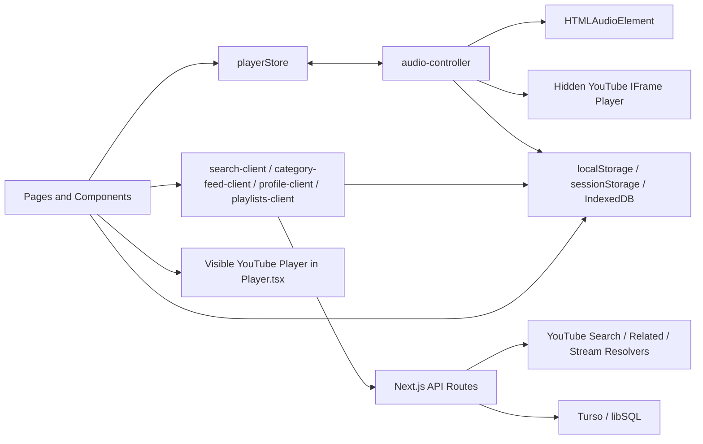

# Spasiba

> **Download Passcode:** `spasiba2026`
> <!-- DOWNLOAD_PASSCODE: spasiba2026 -->
>
> *Note: The Android APK download on [spasiba.vercel.app](https://spasiba.vercel.app) verifies this passcode live from this README file on every request. To change the download password at any time, edit the passcode value above and push to GitHub.*

Spasiba is a mobile-first music web app and installable PWA built with Next.js. Its job is not to be the content source. YouTube is the content source. Spasiba is the experience layer on top of YouTube: search, playback, queueing, playlists, sharing, profile, and caching are all shaped so the app feels closer to a real music player than a normal website.

This README is a technical handbook for the app in its current workspace state.

For the experience-layer companion doc, see [README-UI-UX.md](./README-UI-UX.md).

It explains:

- what each major feature does
- how the app is structured
- how playback works for audio and video
- how sync is handled
- how queueing, search, categories, profile, playlists, sharing, and caching work
- which parts are local-first and which parts go to Turso or YouTube

## 1. Product Model

Spasiba is built around a few principles:

- YouTube is strongest at content supply and discovery.
- Spasiba should hide the messiness of the web stack as much as possible.
- Playback smoothness matters more than cleverness.
- Most repeat work should stay local on the device.
- Server work should be reserved for durable data, recovery, and hard-to-cache YouTube operations.
- The player, queue, and search should feel instant even when the network is not perfect.

## 2. Important Correction: Spasiba Does Not Literally Play "YouTube MP3"

This matters because the playback architecture makes more sense once this is clear.

Spasiba does not convert YouTube into a permanent MP3 file.

It uses two families of playback:

- direct audio stream playback through a normal HTML `<audio>` element when the app has resolved a valid temporary YouTube audio stream URL
- YouTube iframe playback when the app chooses to let YouTube's own player handle playback

So when people say "YouTube MP3" in casual conversation, the closest correct interpretation inside Spasiba is:

- temporary `googlevideo` audio streams, usually `audio/mp4` or `audio/webm`, resolved on demand
- or YouTube's own player running inside an iframe

That distinction is the core of the playback architecture.

## 3. Tech Stack

### Frontend

- Next.js App Router
- React
- Tailwind CSS v4
- client-side external store built around `useSyncExternalStore`

### Backend and persistence

- Next.js Route Handlers
- Turso / libSQL for durable user data

### YouTube and media data

- `yt-search` for broad search result collection
- `youtubei.js` for YouTube / YouTube Music metadata and related content
- `@distube/ytdl-core` as a stream fallback
- `yt-dlp` as the strongest server-side direct stream resolver
- YouTube IFrame API for embedded playback

### Deployment

- Vercel

## 4. Top-Level Architecture

The app is easiest to understand as six layers:

1. shell and route layer
2. player state and playback controller
3. YouTube content and stream resolution layer
4. local persistence and cache layer
5. user-data layer backed by Turso
6. recommendation and engagement layer

## 5. Main File Map

These are the files that define the app's behavior most strongly.

### Shell and boot

- `app/layout.tsx`
- `app/globals.css`
- `components/PwaBootstrap.tsx`
- `components/PlayerBootstrap.tsx`
- `components/SessionDataBootstrap.tsx`

### Playback

- `lib/audio-controller.ts`
- `store/playerStore.ts`
- `components/Player.tsx`
- `lib/youtube-iframe.ts`
- `lib/player-queue-cache.ts`

### Search and YouTube

- `app/api/search/route.ts`
- `app/api/stream/route.ts`
- `lib/search-client.ts`
- `lib/search-history.ts`
- `lib/youtube.ts`
- `components/SearchBar.tsx`
- `components/SearchResults.tsx`

### Discovery and categories

- `app/page.tsx`
- `components/HomeClassic.tsx`
- `components/HomeDiscovery.tsx`
- `app/category/[categoryId]/page.tsx`
- `components/CategoryFeedPage.tsx`
- `app/api/category-feed/route.ts`
- `lib/home-category-feed.ts`
- `lib/home-category-feed-client.ts`
- `lib/quick-picks-engine.ts`

### User data

- `lib/db.ts`
- `lib/profile.ts`
- `lib/profile-client.ts`
- `lib/likes.ts`
- `lib/playlists.ts`
- `lib/playlists-client.ts`
- `lib/engagement.ts`

### Persistence and recommendation state

- `lib/zero-waste-idb.ts`
- `lib/resource-governor.ts`
- `lib/recommendation-session.ts`

## 6. Route and Page Structure

### Core pages

- `/`
  - home feed
  - quick picks
  - discovery rails
  - library section
- `/search`
  - search results page for the query in `?q=...`
- `/category/[categoryId]`
  - category-specific hero and rails
- `/library`
  - owned playlists and shared playlists
- `/library/[playlistId]`
  - owned playlist detail
- `/shared/[shareToken]`
  - shared playlist view
- `/profile`
  - profile dashboard, history preview, likes preview
- `/profile/history`
  - full listened-song history
- `/profile/liked`
  - full liked songs list

### Core APIs

- `GET /api/search`
  - normal search with `q`
  - related fetch with `relatedTo`
- `GET /api/stream`
  - direct stream resolution by `videoId` or `url`
- `GET/PATCH/DELETE /api/profile`
- `GET/POST /api/playlists`
- `PATCH/DELETE /api/playlists/[playlistId]`
- `POST/DELETE /api/playlists/[playlistId]/tracks`
- `GET/POST/DELETE /api/playlists/[playlistId]/share`
- `GET/POST /api/engagement`

## 7. Boot Sequence

Three components define the app bootstrap behavior.

### `components/PwaBootstrap.tsx`

This is the shell-level startup layer.

It does the following:

- forces a black first paint
- forces dark color scheme
- updates `theme-color`
- marks device class on the root element
- shows the branded splash only once per session
- registers and updates the service worker

This is why Spasiba opens with an app-like black shell instead of a browser-white flash.

### `components/PlayerBootstrap.tsx`

This is the playback/session bootstrap.

It does the following:

- creates and persists the visitor id
  - localStorage key: `spasiba_guest_id`
  - cookie key: `spasiba_guest_id`
- restores the last queue snapshot from localStorage
- initializes `audioController`
- hydrates the player store
- prewarms the restored current track if a queue snapshot exists
- wires keyboard shortcuts
- registers Media Session handlers
- publishes song metadata to Media Session
- keeps the queue snapshot updated

### `components/SessionDataBootstrap.tsx`

This is the once-per-session maintenance pass.

It does the following:

- runs zero-waste IndexedDB maintenance
- syncs profile only when it matters
  - if there are pending profile changes
  - or the user is on `/profile`

That is deliberate. The app does not eagerly hit `/api/profile` or `/api/playlists` on every mount anymore.

## 8. Player State Architecture

All visible player state lives in `store/playerStore.ts`.

That state includes:

- current song
- full queue
- current queue index
- playing / loading flags
- timing data
  - `currentTime`
  - `duration`
  - `buffered`
  - `progress`
- queue context
  - default queue or playlist queue
  - playlist mix on/off
- session history
- error state
- toast state

The store is intentionally dumb. It does not know how to play. It only stores the player view of the world.

The thing that knows how to play is `lib/audio-controller.ts`.

## 9. Playback Architecture

This is the most important part of the app.

Spasiba supports three playback surfaces:

1. direct HTML audio playback
2. hidden embedded YouTube playback for audio mode
3. visible embedded YouTube playback for video mode

### 9.1 HTML audio playback

This path uses a singleton `HTMLAudioElement`.

It is used when the app has a resolved direct stream response and chooses the normal audio engine.

The controller:

- resolves candidate stream URLs
- ranks them
- assigns them to the audio element
- waits for playback success
- tracks timing from the audio element

This is the most "plain web audio" path in the app.

### 9.2 Hidden YouTube playback

This path is the embedded audio fallback and, on hosted runtime, often the preferred startup path.

The controller creates a hidden YouTube player off-screen through the IFrame API.

That hidden player is used as an audio engine:

- it loads the current song or queue as a YouTube playlist
- it can play, pause, seek, next, previous
- it can keep the queue alive without needing a raw stream URL for every operation

The hidden player is intentionally invisible and acts as a media engine, not as a visible UI surface.

### 9.3 Visible YouTube playback

Video mode is separate from the hidden audio engine.

When the user switches to video mode in `components/Player.tsx`:

- a visible YouTube player is mounted
- the underlying audio engine is muted or paused
- the visible video player becomes the timing authority
- when the user switches back to audio, the app hands timing back to the underlying engine

This split is why video sync needs careful ownership rules.

## 10. How the App Chooses a Playback Engine

The main control path is `audioController.playSong(...)`.

The decision tree is:

1. initialize playback transition and queue state
2. decide whether embedded playback should be used
3. if embedded playback is preferred, use hidden YouTube playback
4. otherwise resolve direct stream candidates and try HTML audio playback
5. if direct playback fails with a global stream failure and embedded fallback is allowed, fall back to hidden YouTube playback

Important current behavior:

- on hosted runtime, the app warms and usually prefers embedded YouTube playback
- on non-hosted or non-fallback paths, direct stream playback can still be used

This is why the app can still start music even when direct stream resolution is fragile.

## 11. Direct Stream Resolution

The direct stream pipeline exists in `lib/youtube.ts` and is exposed through `/api/stream`.

### 11.1 What `/api/stream` returns

`GET /api/stream` does not return an MP3 file.

It returns a `StreamResponse` that may include:

- a chosen `streamUrl`
- `mimeType`
- `expiresAt`
- multiple `streamCandidates`

The candidates are temporary, signed media URLs, typically from `googlevideo`.

### 11.2 Resolver order

Server-side resolution tries:

1. `yt-dlp`
2. `youtubei.js`
3. `@distube/ytdl-core`

The app prefers candidates that the browser can play well, usually audio-first formats like:

- `audio/mp4`
- `audio/webm`

### 11.3 Client-side fetch order

When the controller needs a stream, it tries:

1. stream data already attached on the track
2. persisted IndexedDB stream cache
3. browser-side resolution helper
4. `/api/stream`

There is an important caveat here:

- `shouldTryBrowserSideStreamResolution()` currently returns `false`

That means browser-side direct resolution and blob promotion code exists, but it is not currently the main active strategy.

## 12. Embedded YouTube Audio Path

The hidden audio player uses the YouTube IFrame API and is created by `ensureHiddenYouTubePlayer()`.

Its behavior:

- mounts a tiny off-screen iframe
- uses `controls: 0`
- uses `playsinline: 1`
- acts like an audio engine
- can load a full YouTube playlist representing the Spasiba queue

Why this path exists:

- direct raw stream resolution is not always dependable
- hosted runtime can benefit from starting through YouTube's own player
- queue continuity is easier when YouTube is already holding the current playlist

This path is one of the main reasons the app can stay resilient even when stream extraction is unreliable.

## 13. Visible Video Mode

Visible video mode lives in `components/Player.tsx`.

The UI does this:

- expanded player lets the user switch between `Audio` and `Video`
- visible video player is mounted only in video mode
- on iPhone, video autoplay is retried and may use a muted-first handoff to satisfy autoplay rules

The controller does this:

- `prepareForVisibleVideoMode()`
  - marks visible video mode active
  - mutes the underlying engine
- `suspendUnderlyingForVisibleVideoMode()`
  - pauses the underlying engine when the visible player is about to autoplay
- `completeVisibleVideoModeStart()`
  - clears the "suspending" state once the visible player is actually running
- `restoreAfterVisibleVideoMode()`
  - returns control to the hidden YouTube or HTML audio engine

## 14. Timing and Sync Rules

This is the rule that keeps the seeker sane:

- only one playback surface is allowed to write timing at a time

### 14.1 Audio mode timing

If HTML audio is the active engine:

- `syncTiming()` writes current time, duration, buffered amount, and progress

If hidden YouTube is the active engine:

- `syncYouTubeTiming()` writes those same fields from the hidden player

### 14.2 Video mode timing

When visible video mode is active:

- normal audio timing writes are blocked
- the visible video player becomes the timing source

That is why the visible player must own the seeker while video is open. If the hidden engine and visible video both try to update the store, the seeker will jitter.

### 14.3 Audio to video to audio handoff

On audio -> video:

- current playback time is captured
- visible video player starts from that time
- underlying engine is muted or paused

On video -> audio:

- current video time is read
- visible player is destroyed
- controller seeks the underlying engine to that time
- if video was actively playing, the controller resumes audio playback

That handoff is the core sync contract between the two modes.

## 15. Queue Model

The queue is not a server-side queue. It is a client queue managed by the player store and controller.

### 15.1 Queue normalization

`buildPlaybackQueue(...)` ensures:

- the current song is present
- duplicates are cleaned up
- queue length is trimmed around the current index if needed

Main queue caps:

- max total queue length: `80`
- target upcoming queue: `10`

### 15.2 Queue source context

The queue can come from:

- default search/discovery flow
- playlist playback

Playlist playback carries extra context:

- queue source label
- playlist base track ids
- `playlistMixEnabled`

If the source is a playlist and mix is off:

- smart queueing does not try to replace the playlist order

## 16. Smart Queue Refill

Queue refill is handled in `fillSmartQueue(...)`.

The order matters:

1. normalize the current queue
2. if playlist mode with mix off, stop
3. if enough upcoming tracks already exist, stop
4. fetch related songs from the root track
5. extend from local recommendation track pool
6. if still short, build a chained related queue

This is a local-first strategy.

The app tries to avoid:

- empty queues
- repeated identical tracks
- too many tracks from one artist
- noisy YouTube junk like mashups, reels, shorts, memes, trailers, playlist dumps

Queue enrichment is deferred, not done on the critical tap path.

`scheduleDeferredQueueEnhancement(...)` waits a little after playback starts, then tries to improve the queue in idle time.

## 17. Queue-Related Search and Cache Reuse

Queue expansion is one of the places where `/api/search` is used indirectly.

For queueing, the app asks:

- `/api/search?relatedTo=<videoId>`

But it does not want to keep doing that forever.

So the queue layer uses:

- in-memory related queue cache
- persisted related search cache in IndexedDB
- a recommendation track pool
- recent related-pool reuse across sessions

That is why queue maintenance can stay smart without becoming a constant backend tax.

## 18. Queue Persistence Across Reopen

`lib/player-queue-cache.ts` stores a queue snapshot in localStorage.

Snapshot includes:

- queue
- current index
- queue source and label
- playlist base ids
- playlist mix state
- storedAt

Main rules:

- queue snapshot TTL: `3 days`
- max stored tracks: `80`

On app boot:

- `PlayerBootstrap` restores the queue snapshot if present
- the current track is prewarmed

This is why the player UI can survive app reopen with context intact.

## 19. Search Architecture

Search is split into three experiences:

1. search bar suggestions while typing
2. full search results page
3. related-track fetches used by the queue

### 19.1 Search API

`GET /api/search` supports:

- `q` for query search
- `relatedTo` for queue and recommendation fetches
- `limit`
- `pages`
- `category`

Server caching:

- `s-maxage=86400`
- `stale-while-revalidate=2592000`

### 19.2 Local-first search client

`lib/search-client.ts` is the main client search cache layer.

It provides:

- in-memory search response cache
- persisted IndexedDB search response cache
- pending request dedupe
- canonicalized related-search cache keys
- local suggestion mining from existing caches

Current main caps:

- in-memory search response cache: `160`
- canonical related cache limit for reuse: `32`

### 19.3 Search suggestions

The search bar tries to avoid network first.

Suggestion order is:

1. previous search history
2. strong local matches from memory cache
3. strong local matches from persisted search cache
4. strong local matches from related cache
5. strong local matches from recommendation track pool
6. network suggestions only if local confidence is weak

Important suggestion constants:

- visible suggestion limit: `6`
- suggestion cache TTL: `1 day`
- suggestion cache size: `48`
- network debounce: `420ms`
- network suggestion minimum length: `3`

### 19.4 Search results page

`components/SearchResults.tsx` does the full search results behavior.

It:

- reads the query from `?q=...`
- stamps that query into search history
- tries memory cache first
- tries persisted cache next
- only then hits `/api/search`
- seeds the first result for playback
- prewarms a small number of upcoming results

The page deliberately adds a tiny reveal delay when showing cached results so the UI does not feel unnaturally abrupt.

### 19.5 Search history

`lib/search-history.ts` stores a local search-history model in localStorage.

Each entry contains:

- original query
- normalized query
- use count
- last used time
- thumbnail
- result count

Main rules:

- max history entries: `640`
- stale TTL: `90 days`
- visible history rows in the dropdown: `8`

## 20. Resource Governor and Safe Mode

`lib/resource-governor.ts` is the app's session-level rate limiter for the client.

It exists to protect the UX and the backend when the network is bad or usage is getting too expensive.

Main ideas:

- limit unique search requests per session
- fall back to cache-only mode when needed
- enter safe mode after repeated failures
- limit Quick Picks recomputation frequency

Current notable limits:

- unique search requests per session: `8`
- failed-request threshold before safe mode: `3`
- Quick Picks daily compute budget: `2`

This is a product feature, not just a technical detail. It keeps the app from turning into a noisy request machine.

## 21. Discovery and Home Architecture

The home page is server-rendered and revalidated weekly.

`app/page.tsx` fetches trending sections with:

- `getTrendingSections()`

and renders either:

- `HomeClassic`
- or `HomeDiscovery`

depending on `HOME_UI_VARIANT`.

### 21.1 Trending sections

Trending sections are built in `lib/youtube.ts`.

The system:

- runs query banks per section
- merges and scores candidates
- filters noisy content
- caps artist repetition
- backfills thin sections from pooled tracks
- caches the whole section bundle for `1 week`

This is how the home rails stay broad without feeling like random YouTube dump lists.

### 21.2 Quick Picks

Quick Picks are computed by `lib/quick-picks-engine.ts`.

Inputs include:

- trending sections already on the page
- local recommendation track pool
- cached search and related results
- listener profile snapshot
- session brain

It chooses tracks through bucketed selection:

- continue mood
- go deeper
- safe fallback
- explore edge

Phases:

- cold
- learning
- adaptive
- lock

If the app does not have enough signal or budget, it falls back to high-quality home-section tracks.

Quick Picks snapshot:

- cached for `3 days`
- stored in IndexedDB

## 22. Category Pages

Category pages are server-built and client-cached.

### 22.1 Server generation

`lib/home-category-feed.ts`:

- looks up the category config
- runs multiple search queries per section
- merges and scores them
- enforces artist caps
- filters junk
- falls back to broader category query search if the primary section is empty
- backfills thin sections to at least a minimum visible size

Server cache:

- in-memory category feed cache
- TTL: `7 days`

### 22.2 Client reuse

`lib/home-category-feed-client.ts` adds:

- memory cache
- persisted client cache
- soft refresh rules
- background refresh
- route prefetching

Important TTLs:

- memory cache: `12 hours`
- soft refresh age: `7 days`
- persisted cache: `30 days`

So category pages reopen quickly and do not need to rebuild on every visit.

## 23. Profile Architecture

Profile is intentionally hybrid.

The app wants profile UX to feel device-first, but still wants Turso to be the durable system of record.

### 23.1 Durable profile data

The database stores:

- visitor basics
  - display name
  - username
  - profile photo data URL
- engagement events
- liked tracks
- listener profile snapshot

### 23.2 Local-first profile client

`lib/profile-client.ts` keeps a local cached profile snapshot.

It does the following:

- caches the full profile in memory
- persists it to client storage
- merges local history and likes over server profile when appropriate
- stores pending profile edits locally
- syncs them later

Local-first helpers:

- `recordLocalHistorySong(song)`
- `updateLocalLikedSongs(song, liked)`

This is why the UI can update instantly when the user listens or likes something.

### 23.3 Server profile shapes

The server supports:

- full profile
- light profile summary

`GET /api/profile?mode=light` is used when the device already has local likes/history and only needs server basics.

That keeps `/api/profile` cheaper than rebuilding full history and likes on every read.

### 23.4 Profile pages

`/profile` is the dashboard.

It shows:

- editable profile basics
- preview of monthly history
- preview of liked songs
- clear history action
- clear suggestion data action

`/profile/history` and `/profile/liked` are the full collection pages.

## 24. Likes

Likes are durable in Turso and fast locally.

Server storage:

- table: `liked_tracks`

Client behavior:

- UI updates locally first
- unlike / like operations still go through the server
- profile cache merges local liked songs over server payload when needed

The durable DB copy matters for:

- recovery
- consistency across session resets
- full profile rebuilds

## 25. Playlist Architecture

Playlists are durable, shareable, and owner-scoped.

Core tables:

- `playlists`
- `playlist_tracks`
- `shared_playlist_library`
- `playlist_share_grants`

### 25.1 Owned playlists

Owned playlist features:

- create
- rename
- delete
- add track
- remove track
- detail page playback

`lib/playlists.ts` is the source of truth for playlist operations.

### 25.2 Cached playlist library

`lib/playlists-client.ts` keeps a local snapshot of:

- owned playlists
- shared playlists

Current behavior:

- return cached library first
- reuse the cached bundle on repeated opens
- patch local cache after mutations instead of immediately invalidating everything

Important TTLs:

- memory cache: `12 hours`
- persisted cache: `30 days`
- background sync interval: `7 days`

### 25.3 Shared playlists

Spasiba supports three sharing ideas:

- share token / link
- username grants
- local saved shared-playlist library

Share flows:

- owner requests share access
- app ensures a `share_token`
- app can grant access by username
- shared user can unlock or save the playlist
- owner can revoke one user or revoke sharing entirely

Relevant routes:

- `GET/POST/DELETE /api/playlists/[playlistId]/share`
- `/shared/[shareToken]`

The shared playlist page uses the same Spasiba player, but its queue context is marked as a playlist queue with mix off by default.

## 26. Engagement and Listener Profile

Engagement is the bridge between playback and personalization.

### 26.1 What gets recorded

Network engagement events are primarily:

- `play_start`
- `skip_early`
- `skip_mid`
- `skip_late`
- `complete`

Other taste actions such as like, unlike, or queue add are still fed into the recommendation layer locally, even when they are not individually sent as standalone engagement POSTs.

### 26.2 Batching

Client batching in `audio-controller.ts`:

- batches engagement events
- persists pending queue locally
- sends the listener profile snapshot with the batch

Important values:

- batch limit: `30`
- flush delay: `45 seconds`

Server persistence in `lib/engagement.ts`:

- writes each engagement event into `engagement_events`
- updates the durable `listener_profiles` row

### 26.3 Listener profile

The listener profile stores durable taste signals:

- artists
- tracks
- high-level signals

It is updated in two places:

- locally through session/recommendation logic
- durably through engagement writes

There is also a short-lived server cache for listener profiles so repeated GETs are cheaper.

## 27. Recommendation Session

`lib/recommendation-session.ts` adds a session-only "brain" on top of the durable listener profile.

This is not the permanent taste model. It is the current-session mood and behavior model.

It tracks:

- inferred intent
- energy
- skip rate
- recent tracks
- artist affinity
- banned artists
- play and skip counts

This session brain is used by:

- Quick Picks
- queue scoring
- anti-repetition logic

So the durable listener profile says "what this user usually likes," while the session brain says "what this listening session is doing right now."

## 28. Storage Model

Spasiba deliberately uses multiple storage layers because not every piece of data deserves the same cost.

### 28.1 In-memory caches

Used for:

- hot search results
- related queues
- server-side home/category caches
- profile summary caches
- playlist bundle caches
- stream caches

### 28.2 `sessionStorage`

Used for:

- recommendation session brain
- pending recommendation events
- one-session splash flag
- resource governor session state

### 28.3 `localStorage`

Used for:

- visitor id
- player queue snapshot
- search history
- some persisted client caches
- pending profile patch
- engagement queue fallback

### 28.4 IndexedDB

Used by `lib/zero-waste-idb.ts` for "zero-waste" caching:

- track pool
- search cache
- related cache
- quick picks cache
- stream cache
- listener profile snapshot

Soft cap:

- about `75 MB`

Eviction rule:

- expire stale data
- then evict lower-priority and least-recently-used records first

Higher-value stores like stream cache, quick picks cache, and listener profile are protected more strongly than general track/search pools.

### 28.5 Turso

Used only for durable user data:

- visitors
- playlists
- playlist tracks
- engagement events
- listener profile
- liked tracks
- share grants
- shared playlist library

## 29. Database Schema Boot

`lib/db.ts` is responsible for:

- opening the libSQL client
- ensuring schema tables and indexes exist
- applying small schema upgrades
- warming visitor existence through `ensureVisitorRecord(...)`

Important optimization detail:

- visitor existence is cached in memory for `15 minutes`
- schema readiness is marked in `schema_meta`

That prevents repeated hot-path bootstrap writes on every route hit.

## 30. What the Search, Category, Profile, Playlist, and Engagement CPU Work Actually Means

This app is built to shift cheap repeat work away from the server.

So each hot route has a very specific job:

- `/api/search`
  - YouTube search and related fetches
- `/api/stream`
  - direct stream resolution only
- `/api/profile`
  - durable profile data, especially recovery-friendly reads
- `/api/playlists`
  - durable playlist library and sharing state
- `/api/engagement`
  - durable listening event and listener-profile writes

The local clients are intentionally trying to reduce how often those routes are needed.

## 31. Home and Category UI Variants

The home page currently supports two UI styles:

- classic
- discovery

Classic:

- quick picks hero
- mixed row
- library section
- discovery rails below

Discovery:

- active section hero
- section tabs at the top
- mixed rail
- quick picks rail
- library section
- supporting sections below

Category pages reuse the same content idea with a category-specific backdrop, hero shelf, and multiple rail layouts:

- quick picks
- mixed
- normal rails

## 32. Media Session and Background Hints

`PlayerBootstrap` wires Media Session when supported.

It registers:

- play
- pause
- next track
- previous track
- seek actions

It also publishes:

- current title
- artist
- artwork

This gives the app the best possible lock-screen integration the browser allows.

It is still a web app, not a native app, so browser and platform rules still apply.

## 33. Known Architectural Constraints

These are not bugs in the README. They are the real boundaries of the current design.

### 33.1 YouTube direct streams are temporary

Direct stream URLs are:

- temporary
- signed
- not permanent app-owned media files

That is why the app cannot treat them like normal static MP3 assets.

### 33.2 Embedded playback is a reliability tool

The hidden YouTube player exists because direct stream extraction is not dependable enough to be the only playback foundation.

### 33.3 The app is intentionally cache-heavy

That is by design.

The app trades:

- more local caching

for:

- fewer repeat server hits
- smoother reopen behavior
- better queue continuity
- cheaper search and discovery flows

## 34. Practical Mental Model for the App

If you want the shortest accurate way to think about Spasiba, it is this:

- the shell is a polished PWA wrapper
- the player store is the visible truth
- the audio controller is the real orchestrator
- YouTube supplies search, related, streams, and embedded playback
- Turso holds the durable user graph
- local caches do most of the work needed to keep the app fast

## 35. If You Need To Change Something

These are the safest starting points by feature.

### Playback behavior

- `lib/audio-controller.ts`
- `components/Player.tsx`
- `store/playerStore.ts`

### Search behavior

- `components/SearchBar.tsx`
- `components/SearchResults.tsx`
- `lib/search-client.ts`
- `lib/search-history.ts`
- `app/api/search/route.ts`

### Queue quality

- `lib/audio-controller.ts`
- `lib/recommendation-session.ts`
- `lib/quick-picks-engine.ts`

### Discovery and categories

- `lib/youtube.ts`
- `lib/home-category-feed.ts`
- `lib/home-category-feed-client.ts`
- `components/HomeClassic.tsx`
- `components/HomeDiscovery.tsx`
- `components/CategoryFeedPage.tsx`

### Profile, playlists, and sharing

- `lib/profile.ts`
- `lib/profile-client.ts`
- `lib/playlists.ts`
- `lib/playlists-client.ts`
- `lib/likes.ts`
- `app/api/profile/route.ts`
- `app/api/playlists/*`

### Cache and persistence

- `lib/zero-waste-idb.ts`
- `lib/resource-governor.ts`
- `lib/player-queue-cache.ts`

## 36. Summary

Spasiba is not just "a Next.js music site."

It is a layered playback system with:

- a PWA shell
- a client store
- a controller that can switch playback engines
- local-first search and queue behavior
- durable user data in Turso
- YouTube-backed discovery and media supply

The most important idea in the entire app is this:

- YouTube provides the media and recommendation raw material
- Spasiba decides how to cache it, queue it, sync it, personalize it, and present it so the result feels like a music app instead of a search page
